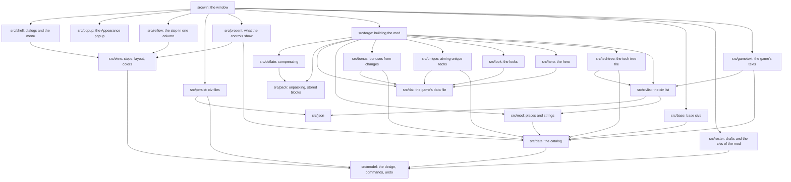

# civeditor: maintainer's guide

1. [Build and test after a change](#build-and-test-after-a-change)
2. [How the code works](#how-the-code-works)
   - [Files and folders](#files-and-folders)
   - [Diagram](#diagram)
   - [How a change reaches the window](#how-a-change-reaches-the-window)
   - [Adding a control to a step](#adding-a-control-to-a-step)
   - [The narrow window](#the-narrow-window)
   - [The catalog files](#the-catalog-files)
   - [Civs to edit and the civs of the mod](#civs-to-edit-and-the-civs-of-the-mod)
   - [How a mod is built](#how-a-mod-is-built)
   - [The rules the code keeps](#the-rules-the-code-keeps)
   - [Tests](#tests)
   - [Rules for changing the code](#rules-for-changing-the-code)

## Build and test after a change

You need Windows, and gcc from [MinGW-w64](https://www.mingw-w64.org/) on the `PATH` (13.2.0 was used). Check it with
`gcc --version` in a terminal.

1. **Open a terminal in the project's folder.** PowerShell, `cmd` or Git Bash all work.
2. **Make the build program, the first time only.** `gcc -o build.exe tools/build/*.c src/core/*.c`. Make it again
   only when a file in `tools/build/` changes.
3. **Build and test.** `build.exe`. It compiles every `.c` file that changed, with the static analyzer, links
   `build\civeditor.exe`, `build\tests.exe` and `build\build_check.exe`, and runs the tests. It ends with
   `Build and tests passed.`, `Build failed.` or `Tests failed.`
   - `Build failed.`: gcc printed the warning or the finding of the analyzer above it, with file and line. Every
     warning is an error here; mend the code, do not silence the warning.
   - `Tests failed.`: each failed test printed `Test N FAILED: what it checks`, and under it where it found the fault.
     Look up Test N in [TESTS.md](TESTS.md) to see what it expects.
4. **Faster while working.** `build.exe quick` skips the analyzer and takes a few seconds. Run `build.exe` once
   before you hand in the change.
5. **Try it.** Start `build\civeditor.exe` and walk through the change by hand.
6. **Write it down.** Add a section to the newest part of `DEVLOG/`, update [TESTS.md](TESTS.md) if a test changed,
   and this guide if the code's shape changed.
7. **Run the mutator** on each folder you changed (Requirement 12), as
   [Rules for changing the code](#rules-for-changing-the-code) shows, and kill what survives.

## How the code works

civeditor is one Win32 program in C11. All memory is fixed when the program starts: there is no `malloc`. The design
being made is one `CivDesign` (in `src/model/civ_design.h`); the window reads it to draw the steps and changes it
only by handing a `Command` to `history_do`, so that every change can be undone.

### Files and folders

| File or folder | What it holds |
| --- | --- |
| `src/core/` | `CHECK` (`check.c`), bounded strings (`text.c`) and reading and writing whole files (`file_io.c`). |
| `src/model/` | `CivDesign`, the design (`civ_design.c`), and whether two designs are alike in a step (`civ_compare.c`); a change to it as a `Command` (`command.c`); undo and redo (`history.c`). |
| `src/base/` | Making a design its base civ: its tech tree, bonuses, looks, unique unit and unique techs with their names, its name, tagline and description (`base_civ.c`). |
| `src/roster/` | The civs of a session: the draft of each civ to edit, and which of them are changed civs, the civs of the mod (`civ_roster.c`). |
| `src/gametext/` | Each civ's tagline and description, read from the game's English strings at the string id the civ list gives (`game_text.c`). |
| `src/json/` | Writing JSON (`json_writer.c`), reading it (`json_reader.c`, `json_string.c`), and changing values in a JSON text while the rest stays byte for byte as it was (`json_patch.c`). |
| `src/persist/` | Civ files: `civ_file_write.c` writes `empireforge_v2`, `civ_file_read.c` reads it and `civbuilder_v1`. |
| `src/data/` | Reading tab-separated text (`tsv.c`), the catalog in `data/` (`catalog.c`) and finding in it (`catalog_lookup.c`). |
| `src/view/` | What the window shows, without Win32: the four steps (`wizard.c`), where each control goes (`layout.c`), the help of each control (`control_help.c`), the colors (`palette.c`). |
| `src/present/` | What each control shows and what picking in it changes (`binding.c`), the summary of Finish and the report of a build (`summary.c`), the text beside a list, the row of a civ in Civ to edit and the window's title (`details.c`). |
| `src/pack/` | Unpacking raw deflate (`inflate.c`, `huffman.c`) and packing in stored blocks (`deflate_store.c`). `inflate.h` holds the tables of deflate's codes. |
| `src/deflate/` | Compressing the mod's dat file with deflate (`deflate.c`), writing the bits with `bit_writer.c`. |
| `src/dat/` | The game's `empires2_x2_p1.dat`: finding its parts, a civ's units and the parts of a unit (`dat_map.c`, with `dat_skip.c` and `dat_field.c`) and writing it anew with changes (`dat_edit.c`). |
| `src/mod/` | Finding the game and its mods folder (`mod_places.c`), the civ's texts (`mod_text.c`), the UI mod's strings file (`mod_strings.c`) and the two folders' `info.json` and the UI mod's files (`mod_ui.c`). |
| `src/forge/` | Building the mod: the changes to the game's data (`recipe.c`, `recipe_copy.c`, `recipe_tree.c`) and the whole build of every changed civ, from the game's file to the two mod folders (`forge.c`). |
| `src/bonus/` | Building a bonus that `bonus_effects.txt` gives as changes and unit patches rather than techs (`bonus_build.c`), and the changes of a bonus scaled by its multiplier (`bonus_scale.c`). |
| `src/unique/` | Aiming a unique tech taken from another civ at the civ's own unique unit (`unique_aim.c`), and copying the tech itself for the civ, with its costs and age (`unique_tech.c`). |
| `src/look/` | Giving the civ the looks of other civs: which civs the design names (`look_sources.c`), and copying their buildings, castle, wonder, monks, kings, trade carts and warships, and the units of look lines (`look_copy.c`). |
| `src/hero/` | Making the civ's hero: finding its unit, training it at the Castle and making it available in the Imperial Age (`hero_build.c`). |
| `src/civlist/` | The civ list, `civilizations.json`: reading the game's, finding a slot's entry and writing it anew with the civ's unique techs, unique unit and description id (`civ_list.c`). |
| `src/techtree/` | The civ's tech tree file, `CivTechTrees\<name>.json`: the game's file with each node of the catalog set to what the design has (`tech_tree.c`), read and written by `tech_tree_file.c`. |
| `src/reflow/` | The step in one column, for a window too narrow or too short for the columns, and how far it scrolls (`reflow.c`); no Win32. |
| `src/shell/` | What the window asks of Windows through one door, so that a test can answer in the user's place: message boxes, the file dialogs, a question answered with a text, such as the mod name, and where the game is (`ask.c`, with the dialog of that question in `text_dialog.c`, which may also offer a list whose picked row fills in the text, as Choose hero... does, under a filter of its rows), how every list scrolls, one row at a time (`list_scroll.c`), and the menu with its keys (`menu.c`). `shell.h` holds them. |
| `src/win/` | The rest of the Win32 code: `winmain.c` starts it, `app_window.c` is the window, `controls.c` makes and draws controls, `assist.c` holds what the window does for accessibility (the text size of Windows, the focus frame, help in the status line, the status line marked for screen readers) and how it scrolls, and runs each message of the loop, `sync.c` keeps them in step with the design, `dialogs.c` opens and saves files, builds the mod and holds Options.... `win_parts.h` holds what they share. |
| `src/popup/` | The Appearance popup: the small window that holds the look choices (`popup.c`). |
| `data/` | The catalog, seven tab-separated text files; see [The catalog files](#the-catalog-files). |
| `tests/` | The test runner (`runner.c`) and the tests, by kind; see [Tests](#tests). |
| `tools/build/` | The build program. `source_list.c` lists the code, says which files make each of the three programs (`PROGRAM_PREFIXES`), where a source's object goes and whether it is still fresh; `build_plan.c` turns the command line into the mode, the folders, the commands of gcc and the arguments of the tests, which the tests check; `build_steps.c` makes the folders, compiles, links and runs the tests with them, each step a function of one decision at most; `build.c` is its `main`. |
| `documentation/` | This guide, `RULES.md`, `REQUIREMENTS.md`, `TESTS.md`, `DECISIONS.md`, `TERMINOLOGY.md`, `BUGS.md` (the bugs found by a human, each with the test that covers it), `DELETION_REQUESTS.md`, and the development log in `DEVLOG/`. |
| `README.md` | Introduces the project. |
| `LICENSE` | The GPL-3.0, under which anyone may use the project. |
| `AGENTS.md` | What an AI agent must know before it changes anything here: what to read first, what it must never do, and when a change is done. |
| `CLAUDE.md` | The same for Claude Code, which reads this file by itself. It loads `AGENTS.md` and `RULES.md`. |
| `.claude/settings.json` | What Claude Code is refused here: committing, pushing, deleting files and changing `REQUIREMENTS.md`. |
| `.claude/skills/` | Step-by-step procedures for AI agents, one folder each, such as how to write the development log. |
| `.github/` | What GitHub shows contributors: how to contribute, report a bug or a security hole, the pull request form, and the WCAG 2.2 checklist of Requirement 4 (`ACCESSIBILITY.md`). |
| `.gitattributes`, `.gitignore` | How Git treats line endings, and which files it leaves out. |

### Diagram

An arrow means that a folder uses another, and each folder uses only folders below it. Left out: `src/core/`, which
all of them use, and the window's direct uses of the folders further down.



### How a change reaches the window

Every change goes the same way, so that it can be undone and the window always shows the design as it is:

1. The user types, picks or ticks in a control. Windows tells `window_procedure` in `app_window.c`, which calls
   `sync_on_notify` in `sync.c`.
2. `sync.c` turns it into a `Command`: `command_set_text` for a text field, or `list_item_command` from `binding.c`
   for a row of a list, such as `COMMAND_TOGGLE_BONUS` with the bonus's id.
3. `history_do` in `history.c` keeps a copy of the design, then applies the command with `command_apply`. If the
   command is refused, such as a 25th bonus, the design stays as it was.
4. `sync_design` sets every control from the design again; its second argument says whether the lists are filled
   anew as well. While it does, `app->syncing` is true, so that the changes it makes are not taken for the user's.

Undo (Ctrl+Z) and redo (Ctrl+Y) swap the design with a kept copy and call `sync_design`. Letters typed one after another
into the same field join one change (`command_joins`), so one undo takes back a whole word.

### Adding a control to a step

1. **Name it.** Add a `CONTROL_...` to `ControlId` in `src/view/layout.h`, before `CONTROL_COUNT`.
2. **Place it.** Add its line to `SPECS` in `layout.c`, in the same place: its step, kind, column, height and label.
   The accessibility tests then check that it is labelled, large enough, and does not overlap another. A step's
   controls go column by column in the order of `ControlId`, left to right, since Tab takes them in that order and a
   test checks that it follows the reading order. At 960 by 640 a column is 468 high: a field or choice with its
   label takes 70 and the gap 8, so a column holds six of them; the controls that stretch share what is left.
   A control placed `PLACE_POPUP` is not in the window at all but in the Appearance popup (see below).
   A control placed `PLACE_FRAME` with a step is in that step's bottom row instead, as the hero's are (see below).
3. **Explain it.** Add its help to `HELP_TEXTS` in `src/view/control_help.c`, at the same place: one or two plain
   sentences, which F1 shows in the status line. A test fails if a control one acts on has none.
4. **Bind it.** Add its line to `BINDINGS` in `src/present/binding.c`: the text field, choice or list it shows.
5. **Build and test**, then look at the step in `build\civeditor.exe`.

The bottom row holds the status line, Back and Next on every step (`bottom_box` in `layout.c`). In UU&UT the Hero box
is left of Back, Choose hero... left of the box, and the hero's name above Choose hero... (`hero_box`); there the
status line ends before them and the columns end above the name (`foot_rise`), so a column is 442 high. Choose
hero... and the name show only while the civ has a hero (`layout_needs_hero`, and `controls_show` in `controls.c`,
which `sync_details` calls after every change, as it ticks or unticks the box to match the design).

### The narrow window

The window lays a step out in one of two ways (`controls_place` in `controls.c`). When it is at least 960 wide and
640 high, at the scale in use, `layout.c` places the list of steps on the left and the step's controls in up to
three columns. When it is narrower or shorter, `src/reflow/reflow.c` places everything in one column as wide as the
window: the list of steps, the title, the help, the step's controls in the order the Tab key takes them, the status
line, and Back and Next side by side. A control that stretches in the wide layout has a fixed height there
(`KIND_HEIGHTS`, by kind of control), and the window scrolls:

- `app->scroll` is how far the step is scrolled, in the layout's units; `assist_scroll_range` in `assist.c` keeps it
  within the step, sets the window's scroll bar, and `controls_place` moves the controls up by it.
- The window's scroll bar is a control of its own, `app->bar` (class `SCROLLBAR`, made by `assist_make_bar`), not
  the scroll bar of the window's frame: `assist_scroll_range` puts it at the right edge and shows it only when the
  step does not fit, and `assist_view` gives the room left beside it, which `room_of` in `controls.c` lays out.
- `assist_scroll` answers the scroll bar, the wheel, and Scroll up and Scroll down of the menu Go. It hands the
  new scroll to `scroll_to`, which keeps it within the step and places the controls again only when it changes:
  placing them redraws the whole window, so a turn of the wheel where the step cannot move must do nothing.
- `assist_follow_focus` scrolls the control in focus into view, with its label.

A list scrolls one row at a time and never slides, though Windows would slide it (smooth scrolling) and move it three
rows a notch of the wheel. `assist_run_message` in `assist.c` is the body of the loop of messages, and it hands each
message to `list_scroll_takes` in `src/shell/list_scroll.c`, which takes a list's wheel and arrows before Windows
does. The dialog of `text_dialog.c` runs its own loop of messages and hands them to it too, so the list of Choose
hero... scrolls as the others do:

- a notch of the wheel over a list moves it one row (`turn_wheel`); a part of a notch, from a fine wheel or a touch
  pad, is kept in `wheel_rest` of `list_scroll.c` until it makes a whole one;
- a press on an arrow of a list's scroll bar moves it one row (`press_arrow`), and the list takes the mouse until the
  button is let go; while it holds it, `LIST_REPEAT_TIMER` moves it a row after 400 ms and then every 50 ms
  (`repeat_arrow`). A press on the bar between the arrows is left to Windows, which moves the list a page;
- `move_list` moves a list with its redrawing turned off (`SetWindowRedraw`), which is what keeps it from sliding, and
  draws it again after. Keys and clicks need nothing of the sort: Windows slides lists whose rows differ in height
  only on the wheel and the arrows;
- a dropdown opens at once: Windows would slide its rows open, but does not when they are shown already, so
  `sync_on_notify` hands a dropdown about to open (`CBN_DROPDOWN`) to `list_scroll_open`, which shows its rows first;
- a notch of the wheel over an open dropdown moves its rows one row too: `wheeled_list` finds the rows of the
  dropdown the wheel was turned over. The arrows of an open dropdown's scroll bar are left to Windows.

`assist_plain_bar` turns the visual styles off for every control made with a vertical scroll bar (`create_child` in
`controls.c` calls it), and for the list of a drop-down choice, so that Windows 11 draws their scroll bars with arrows
and a knob at all times instead of a thin bar that grows under the mouse. A scroll bar control, as the window's is,
draws that bar whatever the visual styles; the window itself keeps them, since without them its title bar would look
like that of Windows 2000.


The window may be as small as 320 by 256 units (`limit_size` in `app_window.c`), which is what a screen 1280 wide
holds at 400%. The rows of a list are as high as their text needs: `assist_wrap_rows` measures each row for the
list's width whenever a list is filled or the window changes size, and `assist_row_format` draws the text on as
many lines. A new control needs nothing for the narrow window: it takes its place after the control before it.

### The catalog files

The lists of the steps come from `data/`, which `catalog.c` reads when the program starts. Each file has one record a
line, its fields split by a tab; a field with nothing in it is `-`, and a list of numbers is split by commas. The
program looks for `data` next to itself, one folder up, and in the folder it was started from.

| File | Fields, in order | Example |
| --- | --- | --- |
| `appearance.txt` | kind (`civ`, `architecture`, `scout`, `monk`, `unranked`), id, name; a `civ` line then five string ids of a civ in its slot: its castle tech, imperial tech, unique unit, elite unit and hero; an `architecture` line then the slot of the civ whose looks it copies; a `monk` line then the slot of the civ whose monks it copies and three of its units: the monk, the dead monk and the monk with a relic; a `base` line, a base civ, then its civ bonuses, team bonus, unique unit, Castle Age tech, Imperial Age tech, architecture, monk skin and scout, `-` or -1 where it has none; an `unranked` line names a civ that is not a ranked civ, which Civ to edit then leaves out | `civ	1	Britons	44008	44009	69802	69803	44500`, `base	1	Britons	0,1,2	2	0	2	2	2	1	448` |
| `bonuses.txt` | id, category, big text, description, the game's techs that make it | `2	economy	+25%	Shepherds work 25% faster	383` |
| `team_bonuses.txt` | id, description, the game's effect that makes it | `0	Relics generate +33% gold	488` |
| `units.txt` | role (`V` the game's own, `C` custom, `H` hero), id, name, food, wood, stone, gold, hit points, attack, melee armor, pierce armor, range, speed, reload, make-available tech, elite tech | `V	0	Longbowman	0	35	0	40	35	6	0	0	5	0.96	2	263	360` |
| `techs.txt` | tier (`castle`, `imperial`), id, name, description, food, wood, stone, gold, time, the game's tech it is copied from | `castle	2	Yeomen	...	0	750	0	450	60	3` |
| `tree.txt` | kind (`unit`, `building`, `tech`), id, name, age, building, parent, lane, whether it is a universal, regional or unique node, the slots of the civs that have it in the game, and `required` or `completed`: the status most civs of the game give it | `unit	185	Slinger	3	87	-	4	regional	21,58,57,59` |
| `bonus_effects.txt` | kind (`civ`, `team`), bonus id, entry, the techs it needs, then a change: type, a, b, c, d; or kind `unit`, bonus id, unit, the field's place in the unit, its type (`u8`, `i16`, `f32`), its value; or kind `train` or `cost`, the same, the place counted from the unit's first train location or its costs; or kind `look`, bonus id, unit, and the civ whose same unit's look it takes; or kind `require`, bonus id, a tech of the game, and a requirement tech of another civ, copied for the civ and added to that tech's requirements | `civ	55	0	102	4	-1	12	8	769.0`, `unit	330	50	29	f32	1.0`, `train	222	705	2	i16	68`, `cost	460	82	2	i16	300`, `look	457	42	47`, `require	103	209	768` |

Ids of `civ` in `appearance.txt` are the game's civ numbers, its slots: 1 is the Britons. A civ file counts the civ of
its language, wonder and castle from 0 for the Britons, as the original does: `civ_file_read.c` adds 1 and
`civ_file_write.c` takes it off, so the design keeps slots. Ids in `tree.txt` and the techs and effects named in the
other files are the game's own numbers in `empires2_x2_p1.dat`. To add a record, add a line; the file must stay UTF-8,
without a byte order mark. `bonus_effects.txt` comes from the original's lists of changes, `ec_list` and `team_ec_list`,
and the lines of bonuses 123, 125, 131, 133, 137, 138, 155, 195, 209, 234, 258, 261, 277, 278, 279, 290, 325, 330, 339,
401, 404 and 458 from the changes its code makes, worked out from the game's data file of 2026-11-09. Those of 123, 125,
137, 138, 195, 234, 258, 277, 278, 279 and 290 list the techs of a building, those of 123, 137, 138 and 290 their costs,
those of 277 the attacks of 18 gunpowder units, and those of 330, 339 and 458 the sizes of the farms, the storage of the
Harbor and the Krepost and the buildings the Thracians build on any elevation, as the game had them then; a game update
that adds such a tech or building, or changes a cost, an attack or one of those fields, leaves them out of date. The
`require` lines of 81, 103, 221, 247, 283 and 352 name the requirement techs that the game gives its own civs for those
bonuses, as the game's data file of 2026-11-17 had them. Those of 455 and 456 put a copy of 638 in the free slot of the
Hoplite's tech (1136) and the Scythian Horse Archer's (1336), which need a tech of the Chronicles, so that the Castle
Age suffices; a `civ` line of 456 disables the Heavy Cavalry Archer (218), as the original takes that line out of the
tree. A `civ` line of 455 sets the cost of 1136, 1 food, to 0, as the game's tech 1261 does for the Chronicles: a tech
that is researched nowhere and costs something never fires. The `civ` lines of 457 multiply the two attacks of the
Trebuchet (42), on buildings (class 11) and pierce (class 3), by 115%, the value packed as the game packs it, the class
times 256 plus the percent (2931 and 883). Its `look` lines dress the Trebuchet and the packed Trebuchet (331) as the
Athenians' (civ 47). No two `require` lines give a requirement to the same tech of the game, since each takes the first
free slot. The `train` lines of 222 move the cow (unit 705) from the Town Center, where the game trains it, to the Mill
(68), at button 3, as the original does. The `unit`, `train` and `cost` lines of 460 make the Castle of the civ cost 300
stone and 500 wood, take 175 seconds to build and have 3000 HP, as the original does. The `unit` lines of 454 give the
Sannahya (2390) 250 HP and its elite (2391) 300, as the original does; the techs of 454 and of 451, named in
`bonuses.txt`, are the game's own. Lines of one bonus with the same entry become one effect, in their order. The catalog
holds up to 4 096 lines of changes, 512 unit patches, `train` and `cost` lines among them, and 32 `require` lines
(`CATALOG_BONUS_CHANGE_CAPACITY`, `CATALOG_UNIT_PATCH_CAPACITY` and `CATALOG_REQUIREMENT_CAPACITY` in `catalog.h`). The
string ids on the `civ` lines are the original's, five for each slot: ids of texts of the game's campaigns, as the
original found that the game takes a UI mod's text only for an id it already has. With the UI mod on, a few lines of
those campaigns show the civ's texts instead.

### Civs to edit and the civs of the mod

The first list of the step Name and tech tree is the civ to edit, the Britons when the window opens. Choosing another
(`choose_civ` in `sync.c`) shows that civ's draft (`roster_draft` in `src/roster/civ_roster.c`) or, the first time,
its base civ, as one change that undo takes back. The design shown is kept as the draft of its civ each time the
window shows it anew (`roster_keep`, called by `sync_details`), so no edit is lost by choosing another civ.
`base_civ_apply` in `src/base/base_civ.c` gives a design its base civ's:

- tech tree: the nodes whose list of civs in `tree.txt` holds the civ's slot;
- civ bonuses, team bonus, unique unit of the game and Castle Age and Imperial Age techs of its `base` line, each
  named as the catalog names it, and no hero;
- slot as language, wonder, castle and the civ it replaces, and the architecture, monk skin and scout of its line;
- name from its `base` line, and tagline and description from the game.

The tagline and description are read when the window opens (`read_game_texts` in `app_window.c`, which asks
`ask_folder` where the game is). `game_text_read` in `src/gametext/game_text.c` takes each civ's
`tech_tree_description_string_id` from the game's `civilizations.json` and finds that string id in
`resources\en\strings\key-value\key-value-strings-utf8.txt`. Its first line, without " civilization", is the
tagline, "Foot Archer" for the Britons; the rest is the description, each `\n` a line break. Without the game both
stay empty. No step has a field for the description: it is kept in the design and the civ file, and
Finish shows it. Picking a unique unit or a unique tech in its list names it as the catalog does
(`list_item_command` in `binding.c`, through `command_pick` in `command.c`); the name can then be changed.

The hero is chosen in UU&UT. Ticking the Hero box picks Attila the Hun, unit 777 (`HERO_AT_FIRST`, by
`hero_box_command` in `binding.c`), named as the catalog names him; unticking it picks no hero. Choose hero...
(`dialogs_choose_hero` in `dialogs.c`) shows the heroes of the catalog, the rows of `CONTROL_HERO_CHOOSE`, in the
dialog of `text_dialog.c`, under a filter and with the hero's name in a field under them. Picking a row puts the
catalog's name of that hero in the field; OK picks the hero with the name in the field, as one change, and Cancel changes nothing.

The list of steps marks a step "(done)" only once the design differs there from its base civ
(`wizard_step_is_done` in `wizard.c`, which compares with `civ_design_same_identity` and the others of
`civ_compare.c`), and Finish once the civ differs from its base civ and lacks nothing. So a new window shows no step
done. Nothing saves a civ into the mod: after every change `sync_details` in `sync.c` hands the design to
`roster_keep`, which keeps it as the draft of its slot and marks the slot as a changed civ when the design differs
from its base civ, and no longer when it is as the game has it again. When the mark flips, Civ to edit is filled
anew, and a changed civ's row ends in an asterisk (`details_civ_row` in `details.c`). The label at the top right of
Finish counts the changed civs (`details_changed`), and Build mod builds them as they are. Save civ file... and Open
civ file... in the menu File save and open the civ shown.

The look choices are not in the first step but in the Appearance popup (`src/popup/popup.c`), a window owned by the
main window, made hidden with it (`popup_make`) and shown by the button Appearance (`popup_show`, from `on_click` in
`sync.c`). Its controls are ordinary controls of the layout, placed `PLACE_POPUP`: `controls.c` makes them children
of the popup, `layout_shows` is false for them on every step, and the popup passes their messages on to the main
window, so each choice changes the design at once and can be undone like any other. Close, Esc and the X hide it.
The popup's class is registered in `app_window.c`, the only file that may name a window procedure.

Every list of a step has a filter above it, named by `filter` of its line in `BINDINGS`. A row stays when it holds
the filter's text, or when the text starts the name of a civ that has the row's item: its node, civ bonus, team
bonus, unique unit or unique tech (`civ_matches` in `binding.c`). Clear under the civ bonuses unticks them all as one
change (`COMMAND_CLEAR_BONUSES`).

Build mod asks only for the mod's name and writes into the mods folder (`app->mods_folder`), found when first
needed (`ask_folder`). Options... in the menu File (`dialogs_options` in `dialogs.c`) shows that folder and takes
another that exists; it is kept until civeditor closes. A build that left nothing out (`summary_build_is_whole`)
shows no message: Finish shows the built mark, `CONTROL_BUILT`, until the next change. A build that left something
out says what in a message, as before, and a build that failed says why.

A civ that a game update adds needs a `civ` and a `base` line in `appearance.txt`, and its slot in the list of civs
of each node of `tree.txt` it has. Those lists come from the game's
`resources\_common\dat\CivTechTrees\<name>.json`: a civ has a node when its `Node Status` is not
`NotAvailable`. Slots run to 63 (`TSV_BIT_LIMIT` in `tsv.h`), since each list is read into a 64-bit mask
(`tsv_bits`); the roster keeps a draft for each (`ROSTER_SLOT_LIMIT`), and a mod has room for as many civs
(`FORGE_CIV_LIMIT`). Two `_Static_assert`s, in `sync.c` and `dialogs.c`, stop the build while these three differ.

### How a mod is built

Build mod... in the window calls `dialogs_build` in `dialogs.c`. It finds the game and its mods folder
(`mod_places.c`), takes the civs saved in the mod (`roster_civ`) and stops if there is none or one is not finished
(`forge_civs_are_finished`), asks for the mod name (`ask_text`; `civeditor_mod` at first, then the last one given)
and whether to build into the mods folder, and calls `forge_build` in `forge.c` with a `ForgeJob` of those civs.
That does, in order:

1. **Read the game's data file**, `resources\_common\dat\empires2_x2_p1.dat`, and unpack it (`inflate_raw`): about
   12 MB become 93 MB.
2. **Map it** (`dat_map_read`): where each effect, civ and tech starts. Only `VER 8.9` is read; a game update that
   changes the format makes this step fail, and `dat_skip.c` must learn the new layout.
3. **Change it** (`recipe_apply`, once for each civ, into one `DatEdit`): the replaced civ's techs are given civ 99,
   two new effects become the civ's team bonus and tech tree, and the techs of the bonuses, the unique unit and the
   unique techs are copied for the civ.
   Each change is a patch over the old bytes, a copy of other bytes of the file, or a new effect or tech at the end
   of its list (`dat_edit.c`), so the new techs of a civ are numbered after those of the civs before it, and a
   requirement added to a tech of the game takes a slot no civ before has patched (`dat_edit_is_patched`). Then
   the civ is given its looks.
4. **Write and pack it** (`dat_edit_write`, then `deflate_pack`): the 93 MB become about 13.5 MB. If they do not fit
   in the buffer, `deflate_store` packs them in stored blocks instead. Then write the folders into the mods folder:

```text
<prefix>-data\info.json
<prefix>-data\resources\_common\dat\empires2_x2_p1.dat
<prefix>-data\resources\_common\dat\civilizations.json
<prefix>-data\resources\_common\dat\CivTechTrees\<name>.json   (one for each civ)
<prefix>-ui\info.json
<prefix>-ui\resources\en\strings\key-value\key-value-modded-strings-utf8.txt   (and 14 more languages)
```

The prefix is the mod name in lower case, every character but a-z, 0-9, `_` and `-` made `_`: "Æsir Kings" gives
`_sir_kings`. The data mod's `info.json` has the mod name as its title, the UI mod's the mod name and " (UI)".
The civ list is written civ by civ, each from the one before (`chain_civ_list`), and one strings file holds every
civ (`mod_strings_write`): each civ's name under the replaced civ's name id from the game's `civilizations.json`,
the line of the civ picker under that id plus 80 000, and the description under it plus 109 879 and again under the
civ's description id, 990 100 plus the slot (`mod_description_sid` in `mod_text.c`), at which the civ list points.
Another mod with a higher priority that sets the game's own description id then no longer hides it. For each unique
tech it holds the name under the string id of the slot in `appearance.txt`, the label of its button under that id
plus 1 000, its tooltip plus 21 000 and the name for the tech tree plus 150 000; the copied tech points at them.

A unique unit of the game that the civ names or describes gets the slot's unit string id, in the slot's copy of the
unit only: `dat_find_unit` finds the unit in the civ, and `recipe_name_unique_unit` patches its name at the id, the
text of its button at the id plus 1 000 and its tooltip plus 100 000. The elite unit and the copied elite tech get the
elite id in the same way. The strings hold the name, "Create" and the name plus 1 000, and the tooltip plus 21 000
and 100 000. The offsets of these three fields in a unit, 3, 7 and 95 bytes from its start, are in `dat_map.h`.

The data mod's civ list is the game's `civilizations.json` with the slot's entry changed, as the original's
`patch_civilizations_list` changes it (`civ_list_write` in `src/civlist/civ_list.c`): `unique_tech_id_1` and
`unique_tech_id_2` become the copied Imperial and Castle techs. With a unique unit of the game, the entry takes its
unit, its elite unit and the copied elite tech, and the line, the icons and the string ids of the game's entry that
has that unit. A unit that no entry has, such as the Bolas Rider, keeps the replaced civ's line and takes its icon,
its name id and its help id less 79 000 from the dat file (`read_own_texts` in `forge.c`), the game's own rule for 61
of its 62 entries. A named unit gets the slot's unit string id and that id plus 21 000 instead. The rest of the file
is written back as it was, so the game's own entries keep their order and form. Both this file and the tech tree file
are changed with `json_patch.c`: each change replaces one value, and every other byte is copied.

The game draws its tech tree screen from `CivTechTrees\<name>.json`, not from the dat file. The data mod's copy is
the game's file of the replaced civ, `<name>` being its `tech_tree_name` in `civilizations.json`, such as `BRITONS`.
Each node of it that `tree.txt` holds is set to the design (`tech_tree_write` in `tech_tree.c`): `NotAvailable` when
the design lacks it; when the design has it and the replaced civ had not, `ResearchRequired` if the node's line in
`tree.txt` ends in `required`, as for the Keep or the Hand Cannoneer, else `ResearchedCompleted`; the other nodes, such
as the unique ones, stay as they were. A node the design has keeps the game's status, so a Keep still needs its
research. Nodes are matched by their `Use Type` and `Node ID` together, since an id such as 875 is both a unit and a
tech.

What a civ keeps is decided in one place, for the dat file and the tech tree file alike: `civ_design_tree_keeps` in
`src/model/civ_design.c`, which `recipe_tree.c` and `tech_tree.c` both ask. A design with an empty tree keeps the
game's whole tree (`civ_design_tree_is_empty`), and every design keeps the Villager, both Town Centers, the Mill and
the two camps, its list `ALWAYS_KEPT`. To keep another node always, add its id there.

What `recipe_apply` built and skipped comes back in a `RecipeReport`, which the window shows. A civ bonus whose line in
`bonuses.txt` names techs is built by copying them. Its lines in `bonus_effects.txt`, if it has any, are built too and
count once, as its techs do, whatever its multiplier: bonus 356 copies the game's pasture techs, and its line disables
the Farms and their upgrades at the Mill. One that names no techs is built from its lines in `bonus_effects.txt`: each
entry becomes a new effect with those changes and a tech of the civ that fires it, free and by itself, once the techs
the entry needs are researched. A `unit` line, a unit patch, sets one field of a unit of the civ in the dat file, so it
holds from the start (`patch_unit` in `bonus_build.c`). The place counts bytes from the start of the unit and stays
within its first 157 bytes, which every unit has (`DAT_UNIT_FIXED_SIZE` in `dat_map.h`); a unit the civ lacks is passed
over. A `train` line or a `cost` line is a unit patch placed in a part of the unit, its `UnitPart` in `catalog.h`: its
first train location, within its 9 bytes (`DAT_TRAIN_LOCATION_SIZE`), or its three costs, within their 18 bytes
(`patch_unit_part` in `bonus_build.c`); a unit without that part leaves the bonus skipped. A `require` line copies a
requirement tech of another civ for the civ, such as 768, which gives one civ of the game the Cavalier in the Castle
Age, and puts the copy in the first free slot of the requirements of the game's tech, such as the Cavalier, 209, as the
game does for its own civs (`recipe_plan_requirement` in `recipe_copy.c`); a tech with no free slot leaves the bonus
skipped. Two lines that require the same tech share one copy. A bonus with neither techs nor lines is skipped. A team
bonus whose effect in the game is missing or empty gets its changes from `bonus_effects.txt` in the same way. To build a
skipped bonus, add its techs to its line in `bonuses.txt`, or its changes or requirements to `bonus_effects.txt`.

A bonus's multiplier, read from the civ file, makes each of its changes count that many times, as the original does
(`bonus_scale` in `bonus_scale.c`): an amount added is multiplied by it, a factor is raised to it, a spawn makes as
many times the units, and armor or attack past 255, the most one change holds, is split into several changes. A
change that sets a value, the spawn limit (resource 234) and the effect function (resource 33) are kept. A multiplier
is 1 to 10 (`CIV_MULTIPLIER_LIMIT` in `civ_design.h`); the design refuses any other. It is applied to the bonuses
built from changes and to the team bonus; a civ bonus made of the game's techs counts once, and the report counts it
(`multipliers_skipped`).

A unique tech is taken from another civ, so its effect is aimed at the civ's own unique unit (`unique_aim.c`). The
other civ's unique unit is the `V` row of `units.txt` whose make-available tech belongs to that civ; the units
themselves are read from the effects of the row's two techs. In the copied effect:

- a change to the other unit's stats (types 0, 4 and 5) goes to the civ's unit, and one to its elite unit to the
  civ's elite unit, unless the effect already makes that change to the civ's unit;
- making the other unit available (type 2) makes the civ's available, and a unit that appears (type 7) is the civ's
  elite unit;
- any other change of whether the other unit can be made, its upgrade (type 3), and making a unit available to the
  team (type 12) are left out;
- every other change is copied as it is.

So a civ whose unique unit is the Longbowman and whose unique tech is Bearded Axe gives the extra range to its
Longbowman and Elite Longbowman, not to the Throwing Axeman. With a custom unique unit there is no unit to aim at,
and the changes to the other unit are left out.

The looks come last (`look_build` in `look_copy.c`), as the original's `_copy_architecture` makes them. The
architecture's line in `appearance.txt` names the civ whose looks it copies, such as the Goths, slot 3, for Central
European. Each unit of the slot takes the graphics of the same unit of that civ, by the unit's class in the source:

- a building, tower, wall or gate (classes 3, 52, 27 and 39): its standing, dying and undead graphics, its damage
  graphics, its building part of 98 bytes and its garrison graphic, and the graphics of the rubble it leaves;
- a king, monk, monk with a relic, trade cart or warship (classes 59, 18, 43, 19 and 22): its standing, dying, undead,
  walking and attack graphics, and those a monk heals with and a trade cart carries with in its tasks;
- the dead monk (unit 134), and the civ's set of building icons.

The castle (82) and the wonder (276) are copied in the same way from the civ chosen for them, or from the architecture's
civ. Next, the monk (125), the dead monk (134) and the monk with a relic (286) take the graphics, the icon and the
graphics of the tasks of the three units that the monk skin's line of `appearance.txt` names, as the original's
`_copy_monk_skin` does: those of a civ, or of a priest of the scenario editor in civ 0, such as units 1023 to 1025 for
the Priest. Without a monk skin they are the architecture's civ's. Then each look line of a bonus that the design has
(`look_dress_units` in `look_sources.c`) gives its unit the graphics, the icon and the walking and attack graphics of
the same unit of the civ it names (`look_copy_unit`), and the frame at which its attack is let go and the place it is
let go from, the 14 bytes that end 9 before the attack graphic (`copy_attack_timing`), as the original's
`_apply_unit_skin` does: bonus 457 dresses the Trebuchet (42) and the packed Trebuchet (331) as the Athenians' (civ 47),
the Palintonon. A unit or civ that the game lacks is left as it is. `look_sources_of` in `look_sources.c` reads which
civs and units the design names. Every look is a copy (`dat_edit_copy`): bytes of the game's file written over others of
the same size, so the file keeps its size and a unit stays where it was. A copy whose bytes are already the same is not
made, and damage graphics of a different count are left as they are. `dat_unit_read` finds where the parts of a unit
start, and the offsets of the fields are in `dat_map.h`.

The hero is made last (`hero_build` in `src/hero/hero_build.c`), as the original's `_place_hero` and
`_apply_hero_unit` make it. `hero_find` finds the hero's unit in the slot; a civ without that unit gets no hero, and
the report says so. The civ's tech tree makes the hero unavailable, and a new tech of the civ, free and researched by
itself once the Imperial Age is, makes it available, one at a time: its effect, `__hero_imp_enable_` and the slot,
sets attribute 126 of the unit to 1 and adds 4 to attribute 127, so that a dead hero can be trained again. The unit
itself is patched: its first train location becomes the Castle (82), button 4, hotkey 16730 and 60 seconds; it costs
500 food and 500 gold; it gets the hero's status (hero mode 1), at least 300 hit points and its own id as both copy
ids, and is not disabled. A named hero gets the slot's hero string id in the same way as a unique unit: the name at
it, "Create" and the name plus 1 000, the tooltip plus 21 000 and 100 000. Those strings are written only for a hero
that was built: `hero_skipped` of the `ModCiv` in `mod_text.h` comes from the report. `DatTarget` in `dat_edit.h`
names the file, its map, the edit and the slot, for the looks, the hero and the bonuses alike.

### The rules the code keeps

The code follows P10, Holzmann's ten rules for safety-critical code, wherever they leave ub-mode's measures whole
(Rule 26). In practice:

- **Loops.** `for` loops only, bounded by what they walk: `index < design->bonus_count`. A count from outside, such
  as a file's, is checked once where it is read, so that no loop inside needs a second bound.
- **Checks.** Data is checked with `CHECK(...)` where it enters: what a file, the game or the user gives. A failed
  check is counted and named, and the build reports the last one. Inside, the code trusts what it was given: a check
  that no caller can fail makes a mutant that no test can kill, so it is left out. A condition on constants alone is
  a `_Static_assert`, which the compiler checks once.
- **Memory.** Fixed arrays only; a buffer too large for the stack is `static` in the one file that uses it.
- **Pointers.** One level only: no `**`, no `a->b->c`. Lists of names are two-dimensional `char` arrays.
- **Choices.** A choice among kinds is an `enum` and one `switch`, never a function pointer.

### Tests

`build.exe` runs the tests; `build\tests.exe` runs them again without building. `tests/runner.c` runs the functional
tests, then the accessibility tests (`tests/accessibility/`), then the maintainability tests
(`tests/maintainability/` and `tests/rules/`), and numbers them as they run. [TESTS.md](TESTS.md) lists every test
by that number. The redundancy tests of `tests/redundancy/` run after them only when asked, as in
`build.exe quick redundancy`, and are numbered on their own, as "Redundancy test 3". They are there to catch mutants
(Requirement 12) and to run code that only the crapper needs run (Requirement 10), so give the mutator's test command
that word too.

| Folder | The tests it holds |
| --- | --- |
| `tests/functional/` | The design, commands and civ files, and `functional_suite.c`, which runs every functional test. |
| `tests/suites/` | The later functional tests in five suites: the recipe and the looks (`build_suite.c`), the mod, its strings and its places (`mod_suite.c`), numbers, text, TSV and JSON (`core_suite.c`), commands, lists, the summary and the details (`model_suite.c`), and the window's dialogs (`shell_suite.c`). `suites.h` holds their sizes. |
| `tests/core/`, `tests/pack/` | Reading numbers, UTF-8, TSV and JSON (`read_tests.c`), the text helpers (`text_tests.c`), writing JSON (`writer_tests.c`); unpacking and packing. |
| `tests/dat/` | The data file and the recipe. `small_dat.c` builds a small data file in memory, `recipe_game.c` runs the recipe on it for eight civs and answers what the tests of `recipe_tests.c` ask. |
| `tests/bonus/` | The changes of a bonus scaled by its multiplier (`scale_tests.c`). |
| `tests/mod/`, `tests/places/`, `tests/look/`, `tests/base/` | A whole mod built from a small game under `build/test_game` into `build/test_mods`, its strings, finding the game and the mods folder under `build/`, the looks, and base civs. |
| `tests/model/`, `tests/design/`, `tests/shell/` | What the lists and Finish show, which steps are done (`wizard_tests.c`), undo and redo (`history_tests.c`), the design and its saved text (`tests/design/`), and the window driven through its dialogs; how the lists scroll (`scroll_tests.c`) and the dropdowns open (`dropdown_tests.c`); the Hero box and Choose hero... (`hero_tests.c`); `window_fixture.c` opens and closes the window for a test, ticks and clicks its controls, and answers Choose hero.... |
| `tests/reflow/` | The one column at a width of 320, scrolling, and the real window made narrow and short. |
| `tests/redundancy/` | The redundancy tests: base civs, picks, which steps are done, the roster and how a civ is told from the civ of the game (`civ_tests.c`), the game's texts (`game_tests.c`), the civ to edit, Save civ, the name of a civ file, Build mod and the mod name, the caret of a field, the bonuses' filter and categories, the focus when the window opens, the steps of the menu Go, the wheel on the minimized window and the dialog of Choose hero... in the real window (`review_tests.c`), the compile command of the build program (`tools/plan_tests.c`), the patches of the dat file found again (`dat/patch_tests.c`), and the builds that are refused, the descriptions in the mod's strings and the room of a tech's requirements and of a description (`mod/built_mod_tests.c`); `redundancy_suite.c` runs them, those that open the window last. |
| `tests/maintainability/`, `tests/rules/`, `tests/scan/` | The rules of the code and of the documents. `tests/scan/` reads the code for them; `gate_tests.c` shows each rule a text that breaks it, `tests/fixtures/broken_rules.txt`; `tool_tests.c` tests the build program's `source_list.c`. |

`build\tests.exe nowindow` leaves out the tests that open the real window, and `build\tests.exe norules` those of
the rules and the documents, which read the documents and ask Git for the project's files; the tests of the build
program still run. `build.exe` passes these words and `redundancy` on, as in `build.exe quick norules`.

No test needs the game, and none writes outside `build/`. A window that a test opens without a script reads the
game's texts if the game is installed; no test looks at them. A test of a dialog never shows one: it tells `ask_script`
(`src/shell/ask.c`) what the user would answer, and reads what was asked with `ask_last_message`. Choose hero... is
answered by `window_fixture_answer` in `tests/shell/window_fixture.c` instead: a hook on the test's thread picks the
row, types the name and posts OK as the dialog starts (`WM_INITDIALOG`), far off the screen, so the dialog runs its
loop of messages once and closes. `window_fixture_filter` has it type in the dialog's filter first.
It keeps what the dialog showed, its rows, the label of its list and whether the list had the focus, for
`window_fixture_asked`; after `window_fixture_refocus` it gives the list the focus again before OK.

To add a test:

1. **Write it** as `bool test_what_it_shows(void)` in the test file of its subject, with one check, and name it in
   that file's header. It must cover a requirement or catch again a bug found before (Rules 5 and 24); a test that
   only Rule 4 would justify is not written.
2. **Give it a place.** Add a `case` for it to a group of its suite, with the words the report prints. A group is a
   `switch` of at most eight tests; start a new group when one is full. In a suite of `tests/suites/` each group
   has an `..._END` number at the top of the file, and the suite's size is in `suites.h`: raise both by one. In
   `redundancy_suite.c` each group has a `..._GROUP_SIZE` at the top: raise it by one, and put a test that opens no
   window in a group before those that `run_window_test` runs, since with `nowindow` the run stops at the first of
   them. If a number is wrong, a test is skipped or the run stops early without a failure, so check that the "tests
   run" of the report is the number of tests in `TESTS.md`.
3. **See it fail.** Run `build.exe quick`, then break the code it guards, see the test fail and undo the break.
4. **Document it** in `TESTS.md`, at its number, and renumber the tests after it. A bug found by a human is a
   row of `BUGS.md`, with the number of its test; when tests are renumbered, renumber it there too.

The test program also holds `src/win/`, so a test can drive the real window: `tests/accessibility/window_tests.c` calls
`app_open` (`app_window.c`), which makes the window and its controls without showing it, sends it the commands of the
menu, asks Windows for the Tab order, and destroys it; `draw_tests.c` has the window draw a row into a picture in
memory and reads the picture. Such a test must never send keys or move the mouse, and must not open a dialog.
It shows the window only when what it checks needs a shown window, as the scroll tests (`scroll_tests.c`) do,
and then far off the screen (`FAR_AWAY`). The libraries the window needs are named once, in `LIBRARIES`
(`tools/build/source_list.c`).

When you add, change or remove a test, update `TESTS.md`.

### Rules for changing the code

`RULES.md` has the full list, and the maintainability tests check most of it.

- No file over 400 lines of code, no function over 60, and no line over 120 characters.
- No folder over 7 files, except `documentation/DEVLOG/`; the main folder may hold 8.
- No two files with the same name, except `SKILL.md`.
- No comments in the code. Explain what needs explaining in this guide instead.
- A change of behaviour starts with a test that fails, and then the smallest change that makes it pass (ub-mode).
- Each test must catch a broken line of the code it guards. To see that it does, swap one operator in that code, such
  as `<` for `<=`, `&&` for `||` or `==` for `!=`, run `build.exe quick`, see the test fail, and undo the swap.
- Requirements 10, 11 and 12 are measured by ub-mode's crapper, dryer and mutator only. They are three projects of
  their own, checked out beside this one in `..\crapper`, `..\dryer` and `..\mutator`; each makes its own Python
  environment the first time it runs. Run them from the project's folder. They pass by every folder named `tests` or
  `build`, so they read `src/`, and `tools/build/` only when its files are named one by one. They write `.metrics\`
  and `target\`, which Git leaves out.
- Do not write a function twice (Requirement 11). `..\dryer\dryer.cmd --threshold 0.8` prints every two functions of
  `src/` that are 80% alike or more, as `DUPLICATE score=...` and the two places, or `No duplicate candidates found.`
  Names and values do not count, only what is called and how the code is built, so two functions of one line that
  make the same call are a pair. Make one function of the two, with what differs as an argument, or let the callers
  make the call.
- Keep each function's CRAP score below 10 (Requirement 10). It needs to know which lines the tests run:
  1. **Run the tests with coverage.** First touch every source, in Git Bash
     `find src tests tools -name "*.c" -exec touch {} +`: gcc adds the counts of a run to those of the runs before
     while an object stays the same, so an object that is not compiled anew counts lines that no test runs any more.
     Then `build.exe coverage redundancy` builds the tests with gcc's `--coverage` in `build\obj_coverage\` and runs
     them with the redundancy tests; gcc writes there what ran.
  2. **Turn it into LCOV.** `..\crapper\.venv\Scripts\python.exe -m gcovr --root . --lcov
     target/coverage/c/lcov.info build/obj_coverage`.
  3. **Score.** `..\crapper\crapper.cmd --use-existing-coverage` prints every function, the worst first, with its
     complexity, coverage and CRAP score; none may reach 10. Split a function, or test what no test runs.
  `--no-coverage` gives the complexity alone. It counts each `if`, loop, `case`, `default`, `?:`, `&&` and `||`, those
  of a `CHECK` too.
- Run the mutator after every change (Requirement 12), on the folders the change touched:
  `..\mutator\mutator.cmd --use-existing-coverage --test-command ".\build.exe quick nowindow norules redundancy"
  src/model`, after
  the three steps above, so that it leaves out the lines no test runs. For `src/win/`, `src/view/`, `src/shell/`,
  `src/present/` and `src/reflow/` leave `nowindow` out, so that the tests of the real window judge them. It prints
  each mutant as `KILLED` or `SURVIVED` and a table by function, and writes `.metrics\mutate\`. Kill a survivor with a
  test of what the user would see, or take out the code that made it if nothing needs it. Each worker builds the
  whole project once in `target\mutation-workers\`, so a file takes a minute or more. Do not change the code while it
  runs, and do not run `build.exe` in the project: the workers read the same files, and the mutator stops with "being
  used by another process" when it cannot clear away a worker while the build program it links is running. A run
  that stops so leaves its workers in `target\mutation-workers\`; they hold links into the project, so remove them
  with care (see `DELETION_REQUESTS.md`). A second run takes only the survivors and the functions that changed.
- Only C and the Win32 API. Nothing is deleted; list it in `DELETION_REQUESTS.md`.
- `REQUIREMENTS.md` defines what the project does, and only the chief developer may change it.
- Record what you change, and why, in the last part of `documentation/DEVLOG/`, under the day's date, and list any
  decision in `DECISIONS.md`.
- Only humans commit. AI agents leave their work for a human to read, test and commit.
