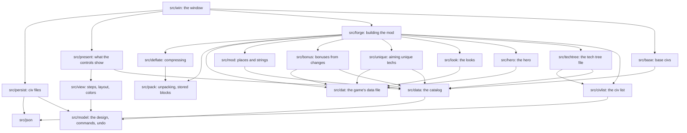

# civbuilder: maintainer's guide

1. [Build and test after a change](#build-and-test-after-a-change)
2. [How the code works](#how-the-code-works)
   - [Files and folders](#files-and-folders)
   - [Diagram](#diagram)
   - [How a change reaches the window](#how-a-change-reaches-the-window)
   - [Adding a control to a step](#adding-a-control-to-a-step)
   - [The catalog files](#the-catalog-files)
   - [Base civs](#base-civs)
   - [How a mod is built](#how-a-mod-is-built)
   - [The rules the code keeps](#the-rules-the-code-keeps)
   - [Tests](#tests)
   - [Rules for changing the code](#rules-for-changing-the-code)

## Build and test after a change

You need Windows, and gcc from [MinGW-w64](https://www.mingw-w64.org/) on the `PATH` (13.2.0 was used). Check it with
`gcc --version` in a terminal.

1. **Open a terminal in the project's folder.** PowerShell, `cmd` or Git Bash all work.
2. **Make the build program, the first time only.** `gcc -o build.exe tools/build/*.c src/core/*.c`. Make it again
   only when a file in `tools/build/` changes.
3. **Build and test.** `build.exe`. It compiles every `.c` file that changed, with the static analyzer, links
   `build\civbuilder.exe`, `build\tests.exe` and `build\build_check.exe`, and runs the tests. It ends with
   `Build and tests passed.`, `Build failed.` or `Tests failed.`
   - `Build failed.`: gcc printed the warning or the finding of the analyzer above it, with file and line. Every
     warning is an error here; mend the code, do not silence the warning.
   - `Tests failed.`: each failed test printed `Test N FAILED: what it checks`, and under it where it found the fault.
     Look up Test N in [TESTS.md](TESTS.md) to see what it expects.
4. **Faster while working.** `build.exe quick` skips the analyzer and takes a few seconds. Run `build.exe` once
   before you hand in the change.
5. **Try it.** Start `build\civbuilder.exe` and walk through the change by hand.
6. **Write it down.** Add a section to the newest part of `DEVLOG/`, update [TESTS.md](TESTS.md) if a test changed,
   and this guide if the code's shape changed.

## How the code works

civbuilder is one Win32 program in C11. All memory is fixed when the program starts: there is no `malloc`. The design
being made is one `CivDesign` (in `src/model/civ_design.h`); the window reads it to draw the steps and changes it
only by handing a `Command` to `history_do`, so that every change can be undone.

### Files and folders

| File or folder | What it holds |
| --- | --- |
| `src/core/` | `CHECK` (`check.c`), bounded strings (`text.c`) and reading and writing whole files (`file_io.c`). |
| `src/model/` | `CivDesign`, the design (`civ_design.c`); a change to it as a `Command` (`command.c`); undo and redo (`history.c`). |
| `src/base/` | Starting a design from a base civ: its tech tree, bonuses, looks, unique unit and unique techs (`base_civ.c`). |
| `src/json/` | Writing JSON (`json_writer.c`), reading it (`json_reader.c`, `json_string.c`), and changing values in a JSON text while the rest stays byte for byte as it was (`json_patch.c`). |
| `src/persist/` | Civ files: `civ_file_write.c` writes `empireforge_v2`, `civ_file_read.c` reads it and `civbuilder_v1`. |
| `src/data/` | Reading tab-separated text (`tsv.c`), the catalog in `data/` (`catalog.c`) and finding in it (`catalog_lookup.c`). |
| `src/view/` | What the window shows, without Win32: the nine steps (`wizard.c`), where each control goes (`layout.c`), the help of each control and the glossary (`control_help.c`), the colors (`palette.c`). |
| `src/present/` | What each control shows and what picking in it changes (`binding.c`), the review (`summary.c`), the text beside a list and the window's title (`details.c`). |
| `src/pack/` | Unpacking raw deflate (`inflate.c`, `huffman.c`) and packing in stored blocks (`deflate_store.c`). `inflate.h` holds the tables of deflate's codes. |
| `src/deflate/` | Compressing the mod's dat file with deflate (`deflate.c`), writing the bits with `bit_writer.c`. |
| `src/dat/` | The game's `empires2_x2_p1.dat`: finding its parts, a civ's units and the parts of a unit (`dat_map.c`, with `dat_skip.c` and `dat_field.c`) and writing it anew with changes (`dat_edit.c`). |
| `src/mod/` | Finding the game and its mods folder (`mod_places.c`), the civ's texts (`mod_text.c`) and the UI mod's strings file (`mod_strings.c`). |
| `src/forge/` | Building the mod: the changes to the game's data (`recipe.c`, `recipe_copy.c`, `recipe_tree.c`) and the whole build, from the game's file to the two mod folders (`forge.c`). |
| `src/bonus/` | Building a bonus that `bonus_effects.txt` gives as changes and unit patches rather than techs (`bonus_build.c`). |
| `src/unique/` | Aiming a unique tech taken from another civ at the civ's own unique unit (`unique_aim.c`). |
| `src/look/` | Giving the civ the looks of other civs: which civs the design names (`look_sources.c`), and copying their buildings, castle, wonder, monks, kings, trade carts and warships (`look_copy.c`). |
| `src/hero/` | Making the civ's hero: finding its unit, training it at the Castle and making it available in the Imperial Age (`hero_build.c`). |
| `src/civlist/` | The civ list, `civilizations.json`: finding a slot's entry and writing it anew with the civ's unique techs, unique unit and description id (`civ_list.c`). |
| `src/techtree/` | The civ's tech tree file, `CivTechTrees\<name>.json`: the game's file with each node of the catalog set to what the design has (`tech_tree.c`), read and written by `tech_tree_file.c`. |
| `src/win/` | The only Win32 code: `winmain.c` starts it, `app_window.c` is the window, `controls.c` makes and draws controls, `assist.c` holds what the window does for accessibility (the text size of Windows, the focus frame, help in the status line, the status line marked for screen readers), `sync.c` keeps them in step with the design, `dialogs.c` opens and saves files and builds the mod. `win_parts.h` holds what they share. |
| `data/` | The catalog, seven tab-separated text files; see [The catalog files](#the-catalog-files). |
| `tests/` | The test runner (`runner.c`) and the tests, by kind; see [Tests](#tests). |
| `tools/build/` | The build program. `source_list.c` says which folders hold code and which files make the test program. |
| `tools/mutate/` | The mutator, `build\mutator.exe`: every mutant of `src/` that the tests do not catch (Rule 34). `mutant_sites.c` finds the places to change, `mutation_run.c` builds and runs one mutant, `mutator.c` shares the work among twelve workers and reports. |
| `tools/dry/` | The dryer, `build\dryer.exe`: every two functions that are 80% alike or more (Rule 31). `dry_shape.c` takes a function's shape and ranks two shapes, `dryer.c` compares and reports. |
| `tools/crap/` | The crapper, `build\crapper.exe`: the CRAP score of every function (Rule 32). `cover_build.c` builds and runs the tests with coverage, `crap_cover.c` reads gcov, `crap_score.c` counts complexity and scores, `crapper.c` reports. |
| `documentation/` | This guide, `RULES.md`, `REQUIREMENTS.md`, `TESTS.md`, `DECISIONS.md`, `TERMINOLOGY.md`, `DELETION_REQUESTS.md`, and the development log in `DEVLOG/`. |
| `README.md` | Introduces the project. |
| `LICENSE` | The GPL-3.0, under which anyone may use the project. |
| `AGENTS.md` | What an AI agent must know before it changes anything here: what to read first, what it must never do, and when a change is done. |
| `CLAUDE.md` | The same for Claude Code, which reads this file by itself. It loads `AGENTS.md` and `RULES.md`. |
| `sitrep&instructions/` | `instructions.md`, the task civbuilder was made for and its limits (C and Win32 only, P10, no deletions); `instructions_2.md`, the answers to the first questions and the trial in the game, with its four pictures; `sitrep.md`, the questions put to the chief developer and how to test the project. |
| `.claude/settings.json` | What Claude Code is refused here: committing, pushing, deleting files and changing `REQUIREMENTS.md`. |
| `.claude/skills/` | Step-by-step procedures for AI agents, one folder each, such as how to write the development log. |
| `.github/` | What GitHub shows contributors: how to contribute, report a bug or a security hole, the pull request form, and the WCAG 2.2 checklist of Requirement 4 (`ACCESSIBILITY.md`). |
| `.gitattributes`, `.gitignore` | How Git treats line endings, and which files it leaves out. |

### Diagram

An arrow means that a folder uses another, and each folder uses only folders below it. Left out: `src/core/`, which
all of them use, and the window's direct uses of the folders further down.



### How a change reaches the window

Every change goes the same way, so that it can be undone and the window always shows the design as it is:

1. The user types, picks or ticks in a control. Windows tells `window_procedure` in `app_window.c`, which calls
   `sync_on_notify` in `sync.c`.
2. `sync.c` turns it into a `Command`: `command_set_text` for a text field, or `list_item_command` from `binding.c`
   for a row of a list, such as `COMMAND_TOGGLE_BONUS` with the bonus's id.
3. `history_do` in `history.c` keeps a copy of the design, then applies the command with `command_apply`. If the
   command is refused, such as a 25th bonus, the design stays as it was.
4. `sync_all` sets every control from the design again. While it does, `app->syncing` is true, so that the changes
   it makes are not taken for the user's.

Undo (Ctrl+Z) and redo (Ctrl+Y) swap the design with a kept copy and call `sync_all`. Letters typed one after another
into the same field join one change (`command_joins`), so one undo takes back a whole word.

### Adding a control to a step

1. **Name it.** Add a `CONTROL_...` to `ControlId` in `src/view/layout.h`, before `CONTROL_COUNT`.
2. **Place it.** Add its line to `SPECS` in `layout.c`, in the same place: its step, kind, column, height and label.
   The accessibility tests then check that it is labelled, large enough, and does not overlap another.
3. **Explain it.** Add its help to `HELP_TEXTS` in `src/view/control_help.c`, at the same place: one or two plain
   sentences, which F1 shows in the status line. A test fails if a control one acts on has none.
4. **Bind it.** Add its line to `BINDINGS` in `src/present/binding.c`: the text field, choice or list it shows.
5. **Build and test**, then look at the step in `build\civbuilder.exe`.

### The catalog files

The lists of the steps come from `data/`, which `catalog.c` reads when the program starts. Each file has one record a
line, its fields split by a tab; a field with nothing in it is `-`, and a list of numbers is split by commas. The
program looks for `data` next to itself, one folder up, and in the folder it was started from.

| File | Fields, in order | Example |
| --- | --- | --- |
| `appearance.txt` | kind (`civ`, `architecture`, `scout`, `monk`), id, name; a `civ` line then five string ids of a civ in its slot: its castle tech, imperial tech, unique unit, elite unit and hero; an `architecture` line then the slot of the civ whose looks it copies; a `monk` line then the slot of the civ whose monks it copies and three of its units: the monk, the dead monk and the monk with a relic; a `base` line, a base civ, then its civ bonuses, team bonus, unique unit, Castle Age tech, Imperial Age tech, architecture, monk skin and scout, `-` or -1 where it has none | `civ	1	Britons	44008	44009	69802	69803	44500`, `base	1	Britons	0,1,2	2	0	2	2	2	1	448` |
| `bonuses.txt` | id, category, big text, description, the game's techs that make it | `2	economy	+25%	Shepherds work 25% faster	383` |
| `team_bonuses.txt` | id, description, the game's effect that makes it | `0	Relics generate +33% gold	488` |
| `units.txt` | role (`V` the game's own, `C` custom, `H` hero), id, name, food, wood, stone, gold, hit points, attack, melee armor, pierce armor, range, speed, reload, make-available tech, elite tech | `V	0	Longbowman	0	35	0	40	35	6	0	0	5	0.96	2	263	360` |
| `techs.txt` | tier (`castle`, `imperial`), id, name, description, food, wood, stone, gold, time, the game's tech it is copied from | `castle	2	Yeomen	...	0	750	0	450	60	3` |
| `tree.txt` | kind (`unit`, `building`, `tech`), id, name, age, building, parent, lane, whether it is a universal, regional or unique node, the slots of the civs that have it in the game, and `required` or `completed`: the status most civs of the game give it | `unit	185	Slinger	3	87	-	4	regional	21,58,57,59` |
| `bonus_effects.txt` | kind (`civ`, `team`), bonus id, entry, the techs it needs, then a change: type, a, b, c, d; or kind `unit`, bonus id, unit, the field's place in the unit, its type (`u8`, `i16`, `f32`), its value | `civ	55	0	102	4	-1	12	8	769.0`, `unit	330	50	29	f32	1.0` |

Ids of `civ` in `appearance.txt` are the game's civ numbers, its slots: 1 is the Britons. A civ file counts the civ of
its language, wonder and castle from 0 for the Britons, as the original does: `civ_file_read.c` adds 1 and
`civ_file_write.c` takes it off, so the design keeps slots. Ids in `tree.txt` and the
techs and effects named in the other files are the game's own numbers in `empires2_x2_p1.dat`. To add a record, add
a line; the file must stay UTF-8, without a byte order mark. `bonus_effects.txt` comes from the original's lists of
changes, `ec_list` and `team_ec_list`, and the lines of bonuses 123, 125, 131, 133, 137, 138, 155, 195, 209, 234,
258, 261, 277, 278, 279, 290, 325, 330, 339, 401, 404 and 458 from the changes its code makes, worked out from the
game's data file of 2026-11-09. Those of 123, 125, 137, 138, 195, 234, 258, 277, 278, 279 and 290 list the techs of a
building, those of 123, 137, 138 and 290 their costs, those of 277 the attacks of 18 gunpowder units, and those of
330, 339 and 458 the sizes of the farms, the storage of the Harbor and the Krepost and the buildings the Thracians
build on any elevation, as the game had them then; a game update that adds such a tech or building, or changes a cost,
an attack or one of those fields, leaves them out of date. Lines of one bonus with the same entry become one effect,
in their order. The catalog holds up to 4 096 lines of changes and 512 unit patches (`CATALOG_BONUS_CHANGE_CAPACITY`
and `CATALOG_UNIT_PATCH_CAPACITY` in `catalog.h`). The string ids on the `civ` lines are the original's, five for each
slot: ids of texts of the game's campaigns, as the original found that the game takes a UI mod's text only for an id
it already has. With the UI mod on, a few lines of those campaigns show the civ's texts instead.

### Base civs

The first list of the Identity step is the base civ. Picking one (`apply_base` in `sync.c`) makes the design the base
civ's, as one change that undo takes back, keeping only the civ's texts and hero. `base_civ_apply` in
`src/base/base_civ.c` gives it:

- the tech tree: Generic, base civ 0, which a new design starts from, has every universal node of `tree.txt`; any
  other base civ has the nodes whose list of civs in `tree.txt` holds its slot;
- the civ bonuses, team bonus, unique unit of the game and Castle Age and Imperial Age techs of its `base` line;
- its slot as language, wonder, castle and the civ it replaces, and the architecture, monk skin and scout of its line.

Every value can be changed afterwards in the later steps. A civ that a game update adds needs a `civ` and a `base` line
in `appearance.txt`, and its slot in the list of civs of each node of `tree.txt` it has. Those lists come from the
game's `resources\_common\dat\CivTechTrees\<name>.json`: a civ has a node when its `Node Status` is not
`NotAvailable`. Slots run to 63 (`TSV_BIT_LIMIT` in `tsv.h`), since each list is read into a 64-bit mask (`tsv_bits`).

### How a mod is built

Build mod... in the window calls `dialogs_build` in `dialogs.c`, which finds the game and its mods folder
(`mod_places.c`), asks, and calls `forge_build` in `forge.c`. That does, in order:

1. **Read the game's data file**, `resources\_common\dat\empires2_x2_p1.dat`, and unpack it (`inflate_raw`): about
   12 MB become 93 MB.
2. **Map it** (`dat_map_read`): where each effect, civ and tech starts. Only `VER 8.9` is read; a game update that
   changes the format makes this step fail, and `dat_skip.c` must learn the new layout.
3. **Change it** (`recipe_apply`): the replaced civ's techs are given civ 99, two new effects become the civ's team
   bonus and tech tree, and the techs of the bonuses, the unique unit and the unique techs are copied for the civ.
   Each change is a patch over the old bytes, a copy of other bytes of the file, or a new effect or tech at the end
   of its list (`dat_edit.c`). Then the civ is given its looks.
4. **Write and pack it** (`dat_edit_write`, then `deflate_pack`): the 93 MB become about 13.5 MB. If they do not fit
   in the buffer, `deflate_store` packs them in stored blocks instead. Then write the folders into the mods folder:

```text
<prefix>-data\info.json
<prefix>-data\resources\_common\dat\empires2_x2_p1.dat
<prefix>-data\resources\_common\dat\civilizations.json
<prefix>-data\resources\_common\dat\CivTechTrees\<name>.json
<prefix>-ui\info.json
<prefix>-ui\resources\en\strings\key-value\key-value-modded-strings-utf8.txt   (and 14 more languages)
```

The prefix is the civ's name in lower case, every character but a-z, 0-9, `_` and `-` made `_`: "Æsir Kings" gives
`_sir_kings`. The strings file holds the name under the replaced civ's name id from the game's `civilizations.json`,
the line of the civ picker under that id plus 80 000, and the description under it plus 109 879 and again under the
civ's description id, 990 100 plus the slot (`mod_description_sid` in `mod_text.c`), at which the civ list points.
Another mod with a higher priority that sets the game's own description id then no longer hides it. For each unique
tech it holds the name under the string id of the slot in `appearance.txt`, the label of its button under that id
plus 1 000, its tooltip plus 21 000 and the name for the tech tree plus 150 000; the copied tech points at them.

A unique unit of the game that the civ names or describes gets the slot's unit string id, in the slot's copy of the
unit only: `dat_find_unit` finds the unit in the civ, and `recipe_name_unique_unit` patches its name at the id, the
text of its button at the id plus 1 000 and its tooltip plus 100 000. The elite unit and the copied elite tech get the
elite id in the same way. The strings hold the name, "Create" and the name plus 1 000, and the tooltip plus 21 000
and 100 000. The offsets of these three fields in a unit, 3, 7 and 95 bytes from its start, are in `dat_map.h`.

The data mod's civ list is the game's `civilizations.json` with the slot's entry changed, as the original's
`patch_civilizations_list` changes it (`civ_list_write` in `src/civlist/civ_list.c`): `unique_tech_id_1` and
`unique_tech_id_2` become the copied Imperial and Castle techs. With a unique unit of the game, the entry takes its
unit, its elite unit and the copied elite tech, and the line, the icons and the string ids of the game's entry that
has that unit. A unit that no entry has, such as the Bolas Rider, keeps the replaced civ's line and takes its icon,
its name id and its help id less 79 000 from the dat file (`read_own_texts` in `forge.c`), the game's own rule for 61
of its 62 entries. A named unit gets the slot's unit string id and that id plus 21 000 instead. The rest of the file
is written back as it was, so the game's own entries keep their order and form. Both this file and the tech tree file
are changed with `json_patch.c`: each change replaces one value, and every other byte is copied.

The game draws its tech tree screen from `CivTechTrees\<name>.json`, not from the dat file. The data mod's copy is
the game's file of the replaced civ, `<name>` being its `tech_tree_name` in `civilizations.json`, such as `BRITONS`.
Each node of it that `tree.txt` holds is set to the design (`tech_tree_write` in `tech_tree.c`): `NotAvailable` when
the design lacks it; when the design has it and the replaced civ had not, `ResearchRequired` if the node's line in
`tree.txt` ends in `required`, as for the Keep or the Hand Cannoneer, else `ResearchedCompleted`; the other nodes, such
as the unique ones, stay as they were. A node the design has keeps the game's status, so a Keep still needs its
research. Nodes are matched by their `Use Type` and `Node ID` together, since an id such as 875 is both a unit and a
tech.

What a civ keeps is decided in one place, for the dat file and the tech tree file alike: `civ_design_tree_keeps` in
`src/model/civ_design.c`, which `recipe_tree.c` and `tech_tree.c` both ask. A design with an empty tree keeps the
game's whole tree (`civ_design_tree_is_empty`), and every design keeps the Villager, both Town Centers, the Mill and
the two camps, its list `ALWAYS_KEPT`. To keep another node always, add its id there.

What `recipe_apply` built and skipped comes back in a `RecipeReport`, which the window shows. A civ bonus whose line in
`bonuses.txt` names techs is built by copying them. One that names none is built from its lines in
`bonus_effects.txt`: each entry becomes a new effect with those changes and a tech of the civ that fires it, free and
by itself, once the techs the entry needs are researched. A `unit` line, a unit patch, sets one field of a unit of
the civ in the dat file, so it holds from the start (`patch_unit` in `bonus_build.c`). The place counts bytes
from the start of the unit and stays within its first 157 bytes, which every unit has (`DAT_UNIT_FIXED_SIZE` in
`dat_map.h`); a unit the civ lacks is passed over. A bonus with neither techs nor lines is skipped. A team bonus
whose effect in the game is missing or empty gets its changes from `bonus_effects.txt` in the same way. To build a
skipped bonus, add its techs to its line in `bonuses.txt`, or its changes to `bonus_effects.txt`.

A unique tech is taken from another civ, so its effect is aimed at the civ's own unique unit (`unique_aim.c`). The
other civ's unique unit is the `V` row of `units.txt` whose make-available tech belongs to that civ; the units
themselves are read from the effects of the row's two techs. In the copied effect:

- a change to the other unit's stats (types 0, 4 and 5) goes to the civ's unit, and one to its elite unit to the
  civ's elite unit, unless the effect already makes that change to the civ's unit;
- making the other unit available (type 2) makes the civ's available, and a unit that appears (type 7) is the civ's
  elite unit;
- any other change of whether the other unit can be made, its upgrade (type 3), and making a unit available to the
  team (type 12) are left out;
- every other change is copied as it is.

So a civ whose unique unit is the Longbowman and whose unique tech is Bearded Axe gives the extra range to its
Longbowman and Elite Longbowman, not to the Throwing Axeman. With a custom unique unit there is no unit to aim at,
and the changes to the other unit are left out.

The looks come last (`look_build` in `look_copy.c`), as the original's `_copy_architecture` makes them. The
architecture's line in `appearance.txt` names the civ whose looks it copies, such as the Goths, slot 3, for Central
European. Each unit of the slot takes the graphics of the same unit of that civ, by the unit's class in the source:

- a building, tower, wall or gate (classes 3, 52, 27 and 39): its standing, dying and undead graphics, its damage
  graphics, its building part of 98 bytes and its garrison graphic, and the graphics of the rubble it leaves;
- a king, monk, monk with a relic, trade cart or warship (classes 59, 18, 43, 19 and 22): its standing, dying, undead,
  walking and attack graphics, and those a monk heals with and a trade cart carries with in its tasks;
- the dead monk (unit 134), and the civ's set of building icons.

The castle (82) and the wonder (276) are copied in the same way from the civ chosen for them, or from the
architecture's civ. Last, the monk (125), the dead monk (134) and the monk with a relic (286) take the graphics, the
icon and the graphics of the tasks of the three units that the monk skin's line of `appearance.txt` names, as the
original's `_copy_monk_skin` does: those of a civ, or of a priest of the scenario editor in civ 0, such as units 1023
to 1025 for the Priest. Without a monk skin they are the architecture's civ's. `look_sources_of` in `look_sources.c`
reads which civs and units the design names. Every look is a copy (`dat_edit_copy`): bytes of the game's file written
over others of the same size, so the file keeps its size and a unit stays where it was. A copy whose bytes are already
the same is not made, and damage graphics of a different count are left as they are. `dat_unit_read` finds where the
parts of a unit start, and the offsets of the fields are in `dat_map.h`.

The hero is made last (`hero_build` in `src/hero/hero_build.c`), as the original's `_place_hero` and
`_apply_hero_unit` make it. `hero_find` finds the hero's unit in the slot; a civ without that unit gets no hero, and
the report says so. The civ's tech tree makes the hero unavailable, and a new tech of the civ, free and researched by
itself once the Imperial Age is, makes it available, one at a time: its effect, `__hero_imp_enable_` and the slot,
sets attribute 126 of the unit to 1 and adds 4 to attribute 127, so that a dead hero can be trained again. The unit
itself is patched: its first train location becomes the Castle (82), button 4, hotkey 16730 and 60 seconds; it costs
500 food and 500 gold; it gets the hero's status (hero mode 1), at least 300 hit points and its own id as both copy
ids, and is not disabled. A named hero gets the slot's hero string id in the same way as a unique unit: the name at
it, "Create" and the name plus 1 000, the tooltip plus 21 000 and 100 000. Those strings are written only for a hero
that was built: `hero_skipped` of the `ModCiv` in `mod_text.h` comes from the report. `DatTarget` in `dat_edit.h`
names the file, its map, the edit and the slot, for the looks, the hero and the bonuses alike.

### The rules the code keeps

The code follows P10, Holzmann's ten rules for safety-critical code. In practice:

- **Loops.** Only `for`, and its condition always holds a bound in capitals: `(index < count) && (index <
  CIV_BONUS_CAPACITY)`. No `while`, no `do`.
- **Checks.** Each function starts by checking its arguments with `CHECK(...)`, and returns a safe value when one
  fails: `if (!CHECK(design != NULL)) { return false; }`. A failed check is counted and named, and the build reports
  the last one.
- **Memory.** Fixed arrays only; a buffer too large for the stack is `static` in the one file that uses it.
- **Pointers.** One level only: no `**`, no `a->b->c`. Lists of names are two-dimensional `char` arrays.
- **Choices.** A choice among kinds is an `enum` and one `switch`, never a function pointer.

### Tests

`build.exe` runs the tests; `build\tests.exe` runs them again without building. `tests/runner.c` runs the functional
tests (`tests/functional/`, with those of unpacking in `tests/pack/`, of the data file in `tests/dat/`, of the mod
and its tech tree in `tests/mod/` and of base civs in `tests/base/`), then the accessibility tests
(`tests/accessibility/`), then the maintainability tests (`tests/maintainability/` and `tests/rules/`), and numbers
them as they run. No test needs the game: the tests of the data file build a small one in memory, and those of the
tech tree a small tree. [TESTS.md](TESTS.md) lists every test by that number. A test is a `case` in the `switch` of
its suite, such as `functional_suite.c`; a suite's groups, such as `run_base_test`, keep each `switch` within 60 lines.
The tests of the tools, such as the crapper's, are the group `run_tool_test` of `maintainability_suite.c`.

The test program also holds `src/win/`, so a test can drive the real window: `tests/accessibility/window_tests.c` calls
`app_open` (`app_window.c`), which makes the window and its controls without showing it, sends it the commands of the
menu, asks Windows for the Tab order, and destroys it; `draw_tests.c` has the window draw a row into a picture in
memory and reads the picture. Such a test must never show the window, send keys or move the
mouse, and must not open a dialog. The libraries the window needs are named once, in `source_test_libraries`
(`tools/build/source_list.c`).

There may be at most 100 tests. When you add, change or remove one, update `TESTS.md`.

### Rules for changing the code

`RULES.md` has the full list, and the maintainability tests check most of it.

- No file over 400 lines of code, no function over 60, and no line over 120 characters.
- No folder over 7 files, except `documentation/DEVLOG/`; the main folder may hold 8.
- No two files with the same name, except `SKILL.md`.
- No comments in the code. Explain what needs explaining in this guide instead.
- A change of behaviour starts with a test that fails, and then the smallest change that makes it pass (Rule 33).
- Each test must catch a broken line of the code it guards (Rule 34). To see that it does, swap one operator in that
  code, such as `<` for `<=`, `&&` for `||` or `==` for `!=`, run `build.exe quick`, see the test fail, and undo the
  swap. `build\mutator.exe src/model/` does it for every operator and constant of a folder or a file of `src/`, after
  `build.exe`: it prints the mutants that survived and writes all of them to `build\mutants.txt`, each with `K`
  (killed), `S` (survived), `N` (did not compile), `T` (ended after 30 seconds) or `U` (on a line no test runs).
  Without a folder it takes all of `src/`, which takes long. Do not build while it runs. It leaves `src/win/` out and
  runs the tests without those of the real window (`build\tests.exe nowindow`), which are slow when many run at once;
  check a change of `src/win/` by breaking it by hand and running `build.exe quick`.
- Keep each function's CRAP score below 10 (Rule 32). After `build.exe`, run `build\crapper.exe`: it builds the tests
  once more with coverage in `build\cover\`, runs them, prints every function at 10 or above and writes all of them
  to `build\crap.txt`, the worst first, as `score  CC complexity  covered taken of branches  file:line  function`.
  To bring a function down, split it into smaller ones or have a test run the branches it misses. Many functions
  are still above 10; do not add to them.
- Do not write a function twice (Rule 31). After `build.exe`, run `build\dryer.exe`: it prints every two functions
  that are 80% alike or more, as `rank  file:lines function  file:lines function`, and writes those at 60% or more
  to `build\dry.txt`. Names do not count, only what is called and how the code is built. Make one function of the
  two, with what differs as an argument. Pairs are still listed; do not add to them.
- Only C and the Win32 API. Nothing is deleted; list it in `DELETION_REQUESTS.md`.
- `REQUIREMENTS.md` defines what the project does, and only the chief developer may change it.
- Record what you change, and why, in the last part of `documentation/DEVLOG/`, under the day's date, and list any
  decision in `DECISIONS.md`.
- Only humans commit. AI agents leave their work for a human to read, test and commit.
