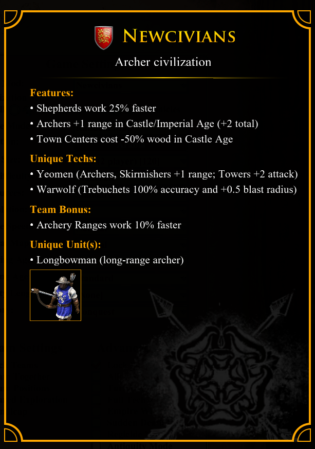
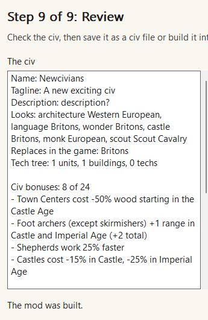
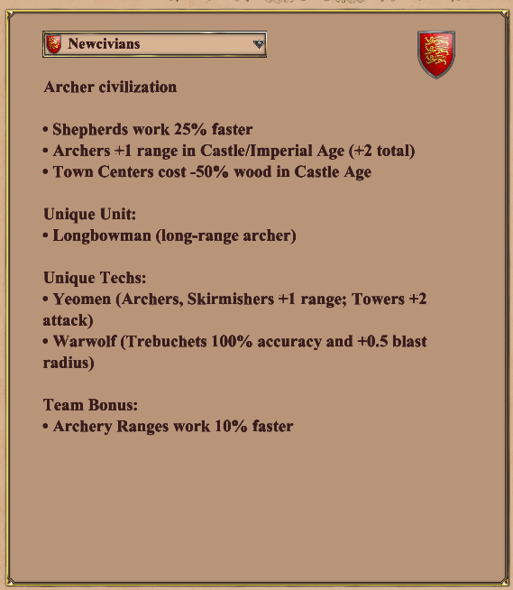
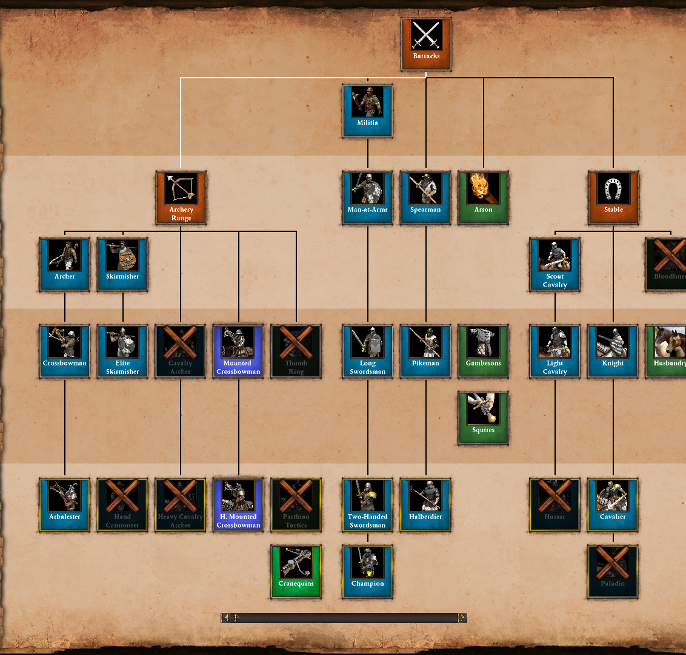

# Answers to questions in sitrep.md

1. Accepted with amendment. See REQUIREMENTS.md.
2. Keep GPL-3.0.
3. Yes, do it. Also I want you to derive rules from Uncle Bob mode (https://github.com/unclebob/ub-mode). I currently don't have its tools (crapper, dryer, mutator) installed yet, so it's not yet usable as a skill. But you can still adopt the principles. It has the same author as CC. Do note: I am not forbidding you from making aforementioned tools in C for this project so that the skill works.
4. No, leave this to the reponsibility of the human.
5. Yes, do this before anything else.
6. Fixed.
7. They are allowed. Line 16 concerns files and directories on the disk, not objects in the code.
8. Fixed.
9. Leave it in root. Rule 14 has been amended.
10. Proposal accepted.
11. Proposal accepted.
12. Proposal accepted.
13. Proposal rejected. This is Civ Builder version 1.0.0 until I tell you otherwise.
14. Proposal accepted.
15. Proposal accepted.

# Manual test results

## Civ Builder bugs
Bug 1: at 3. Civ bonuses, when user clicks an item, the application scrolls up by itself (unwanted UI behaviour).
Bug 2: Checkboxes give a rectangle instead of a check when selected.
Bug 3: 9. Review has a Next button even though there is no next page.
## Output bugs in-game
Bug 4: Bonus preview in civ selection does not show new values; image attachment
. See civbuilder summary for comparison: 
Bug 5: The tech tree bonus descriptions are also incorrect: 
Bug 6: Newcivians (test civ) have plenty of units available in the tech tree when they're supposed to just have town center and villagers, as per civbuilder settings: 
Observation 7: In-game, the barracks is not available (matches with civbuilder settings but not with tech tree)

I did not test further than that.

# New orders

New functionality I want implemented ASAP: all civ features are by default the original of selected base civ. 1. Identity should have a new and primary dropdown Base civ which then sets all other values. Eg. Britons will then have tech tree, bonuses and all other of Britons, which the user then can edit. Currently The tech tree starts blank, not even universal objects are on by default. Default base civ is "Generic" which leaves all regional and unique unselected but all universal enabled. See civexplorer.net for data on what is universal.